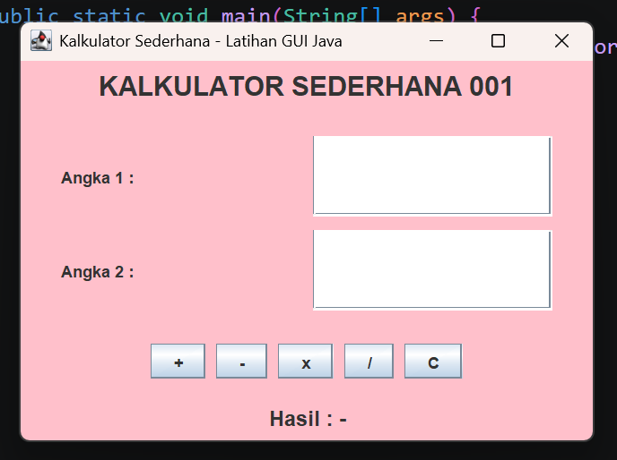
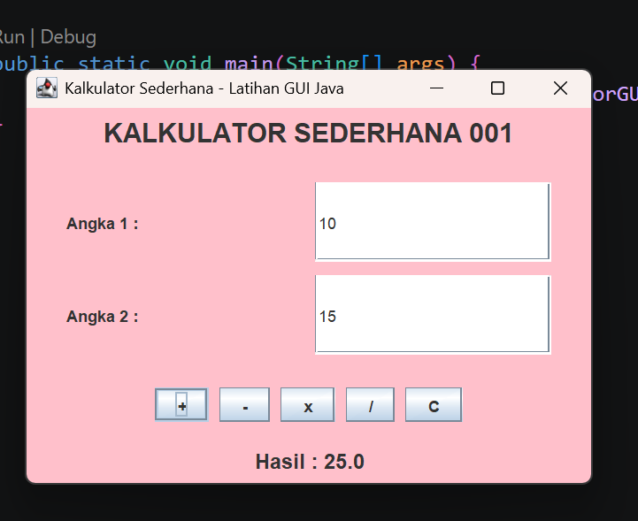
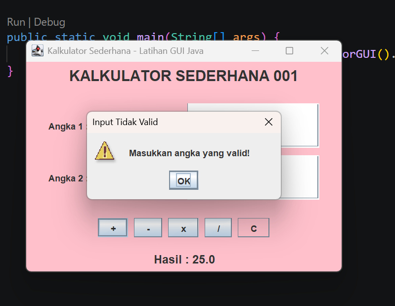
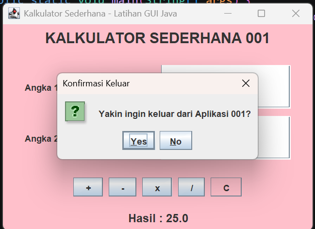

# Latihan/Eksplorasi GUI pada Java

NIM  : F1D02510001
Nama : Annisa Mardatillah

## Deskripsi
Aplikasi Kalkulator Sederhana berbasis Java Swing untuk latihan membuat GUI.

## 5 Komponen Utama GUI yang Digunakan

### 1. Top-level Container Class
JFrame: jendela utama aplikasi. Dibuat dengan `extends JFrame`.

### 2. Intermediate Container Class
JPanel: wadah di dalam JFrame untuk mengelompokkan komponen (panel judul, panel input, panel tombol).

### 3. Atomic Component Class
JLabel (teks), JTextField (kolom input angka), JButton (tombol operasi).

### 4. Layout Classes
- BorderLayout: mengatur frame (NORTH, CENTER, SOUTH)
- GridLayout: mengatur panel input (2 x 2) dan panel selatan
- FlowLayout: mengatur panel judul dan panel tombol

### 5. Event Listener
- ActionListener (interface): override actionPerformed untuk semua tombol
- MouseAdapter (adapter class): override mouseEntered dan mouseExited pada tombol C
- WindowAdapter (adapter class): override windowClosing untuk dialog konfirmasi keluar

## Cara Menjalankan
    cd src
    javac KalkulatorGUI.java
    java KalkulatorGUI

## Screenshot
### Tampilan awal

### Hasil perhitungan

### Error input

### Dialog keluar

